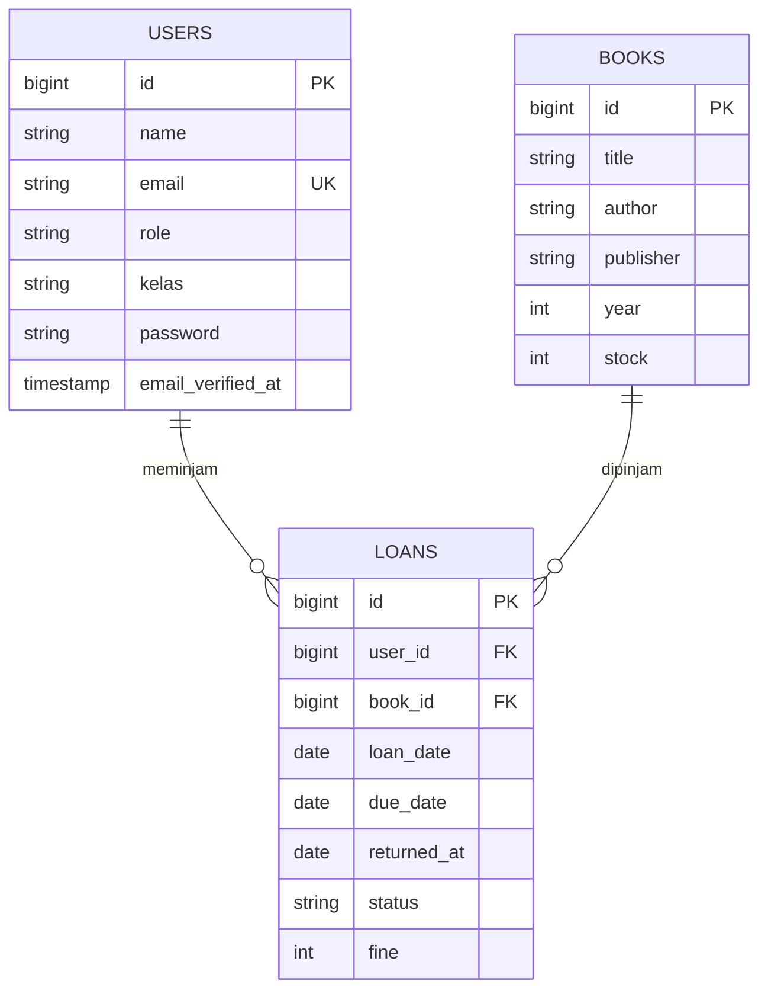

# Aplikasi Peminjaman Buku

Aplikasi web berbasis Laravel untuk mengelola data buku dan peminjaman buku di perpustakaan sekolah.

## Deskripsi Program

Aplikasi ini mencatat data buku, data pengguna, dan transaksi peminjaman. Ada dua jenis pengguna, ditentukan oleh kolom `role` pada tabel `users`:

- **admin**: mengelola data buku dan peminjaman.
- **siswa** (default): pengguna yang meminjam buku. Memiliki data `kelas`.

Alur peminjaman:

1. Siswa meminjam buku, lalu sistem membuat data `loans` dengan `loan_date`, `due_date`, dan `status` bawaan `dipinjam`.
2. Saat buku dikembalikan, `returned_at` diisi tanggal pengembalian dan `status` diperbarui.
3. Jika pengembalian melewati `due_date`, denda dicatat pada kolom `fine`.

Status pengerjaan saat ini: struktur database (migration) dan model sudah dibuat. Route baru berisi halaman awal, sedangkan controller untuk buku dan peminjaman belum dibuat.

## Fitur

- **Books**: data buku (judul, penulis, penerbit, tahun, stok).
- **Loans**: data peminjaman (tanggal pinjam, batas kembali, tanggal kembali, status, denda).
- **Users**: pengguna dengan peran dan kelas.

## Teknologi

- PHP & Laravel
- MySQL (XAMPP)
- Composer

## ERD



## Dokumentasi Fungsi / Prosedur

### Model `Book` (`app/Models/Book.php`)

| Elemen | Jenis | Keterangan |
|--------|-------|------------|
| `$fillable` | properti | Kolom yang boleh diisi massal: `title`, `author`, `publisher`, `year`, `stock`. |

### Model `Loan` (`app/Models/Loan.php`)

| Elemen | Jenis | Parameter | Return | Keterangan |
|--------|-------|-----------|--------|------------|
| `$fillable` | properti | - | - | `user_id`, `book_id`, `loan_date`, `due_date`, `returned_at`, `status`, `fine`. |
| `$casts` | properti | - | - | `loan_date`, `due_date`, `returned_at` otomatis menjadi objek tanggal (Carbon). |
| `user()` | fungsi relasi | - | `BelongsTo` | Mengambil user peminjam melalui `user_id`. Contoh: `$loan->user->name`. |
| `book()` | fungsi relasi | - | `BelongsTo` | Mengambil buku yang dipinjam melalui `book_id`. Contoh: `$loan->book->title`. |

### Model `User` (`app/Models/User.php`)

| Elemen | Jenis | Parameter | Return | Keterangan |
|--------|-------|-----------|--------|------------|
| `$fillable` | properti | - | - | `name`, `email`, `password`, `role`, `kelas`. |
| `$hidden` | properti | - | - | `password` dan `remember_token` disembunyikan saat data diubah ke array/JSON. |
| `casts()` | fungsi | - | `array` | `email_verified_at` menjadi datetime, `password` otomatis di-hash. |
| `isAdmin()` | fungsi | - | `bool` | `true` jika `role` bernilai `admin`, selain itu `false`. |

### Route (`routes/web.php`)

| Method | URL | Proses | Output |
|--------|-----|--------|--------|
| GET | `/` | Menjalankan closure | Menampilkan view `welcome` |

## Debugging

### Temuan pada kode saat ini

| No | Masalah | Dampak | Perbaikan |
|----|---------|--------|-----------|
| 1 | Model `Book` belum punya relasi ke `Loan`. | `$book->loans` menghasilkan error karena relasi tidak ditemukan. | Tambahkan `hasMany` (lihat di bawah). |
| 2 | Model `User` belum punya relasi ke `Loan`. | `$user->loans` tidak bisa dipakai untuk riwayat pinjam siswa. | Tambahkan `hasMany` (lihat di bawah). |
| 3 | Belum ada controller dan route untuk books dan loans. | Fitur belum bisa diakses dari browser. | Buat `BookController` dan `LoanController`, lalu daftarkan di `routes/web.php`. |
| 4 | Nilai `status` ditulis sebagai string bebas. | Mudah typo sehingga filter tidak cocok. | Gunakan konstanta atau enum PHP. |
| 5 | Stok belum terhubung dengan peminjaman. | Stok bisa tidak sinkron atau minus. | Kurangi stok saat pinjam, tambah saat kembali, di dalam `DB::transaction()`. |

Perbaikan temuan 1 dan 2:

```php
// app/Models/Book.php
use Illuminate\Database\Eloquent\Relations\HasMany;

public function loans(): HasMany
{
    return $this->hasMany(Loan::class);
}
```

```php
// app/Models/User.php
use Illuminate\Database\Eloquent\Relations\HasMany;

public function loans(): HasMany
{
    return $this->hasMany(Loan::class);
}
```

### Error umum dan solusinya

| Error | Penyebab | Solusi |
|-------|----------|--------|
| `Base table or view not found` / `Failed to open the referenced table` saat migrate | Migration `loans` berjalan sebelum `users` atau `books` karena timestamp nama file lebih awal. | Pastikan nama file migration `loans` punya timestamp paling akhir, lalu `php artisan migrate:fresh`. |
| `SQLSTATE[23000]: Integrity constraint violation` | `user_id` atau `book_id` yang dimasukkan tidak ada di tabel induk. | Pastikan data user dan buku sudah ada sebelum membuat peminjaman. |
| `MassAssignmentException` | Kolom belum ada di `$fillable`. | Tambahkan kolom ke `$fillable` pada model. |
| `Call to undefined relationship` | Relasi belum didefinisikan di model. | Tambahkan fungsi relasi (lihat perbaikan di atas). |
| `Class "App\Models\Loan" not found` | Namespace atau nama file salah. | Cek `namespace` dan nama file, lalu `composer dump-autoload`. |

### Cara melacak bug

- Cetak nilai variabel: `dd($loan);` atau `dump($request->all());`
- Catat ke log: `Log::info('data pinjam', $data);`, lalu baca `storage/logs/laravel.log`.
- Cek daftar route: `php artisan route:list`
- Cek status migration: `php artisan migrate:status`
- Uji model lewat console: `php artisan tinker`, misalnya `App\Models\Loan::with('user','book')->first();`
- Aktifkan `APP_DEBUG=true` di `.env` saat pengembangan agar pesan error lengkap tampil.

## Instalasi

1. Clone repository

   ```bash
   git clone https://github.com/kalilasyifazzahra/peminjaman-buku.git
   cd peminjaman-buku
   ```

2. Install dependency

   ```bash
   composer install
   ```

3. Salin file environment dan generate key

   ```bash
   cp .env.example .env
   php artisan key:generate
   ```

4. Buat database (misalnya `peminjaman_buku`) di phpMyAdmin, lalu atur `.env`

   ```env
   DB_CONNECTION=mysql
   DB_HOST=127.0.0.1
   DB_PORT=3306
   DB_DATABASE=peminjaman_buku
   DB_USERNAME=root
   DB_PASSWORD=
   ```

5. Jalankan migrasi

   ```bash
   php artisan migrate
   ```

6. Jalankan aplikasi

   ```bash
   php artisan serve
   ```

   Buka `http://127.0.0.1:8000` di browser.

## Database

File database tersedia di `database/peminjaman_buku.sql`.
Import lewat phpMyAdmin (tab Import), atau jalankan `php artisan migrate`.

## Laporan Evaluasi

### Tujuan

Membuat aplikasi berbasis Laravel untuk mengelola data buku dan transaksi peminjaman buku perpustakaan.

### Hasil yang Dicapai

- Perancangan database: tabel `users`, `books`, dan `loans` beserta ERD (relasi one-to-many).
- Migration dan model `Book`, `Loan`, `User`, dengan relasi `Loan` ke `User` dan `Book`.
- Pembedaan peran pengguna lewat kolom `role` (`admin` dan `siswa`).
- Dokumentasi: deskripsi program, dokumentasi fungsi, dan panduan debugging.
- File database `database/peminjaman_buku.sql`.
- Project tersimpan di GitHub.

### Kendala

- Push ke GitHub sempat gagal (`Repository not found` dan `rejected`), diselesaikan dengan memperbaiki remote dan `git pull --rebase`.
- Urutan migration perlu dicek agar tabel `loans` dibuat setelah `users` dan `books`.

### Kekurangan

- Controller, route, dan tampilan untuk books dan loans belum dibuat.
- Relasi `loans()` pada model `Book` dan `User` belum ada.
- Logika stok dan perhitungan denda belum diimplementasikan.
- Belum ada pengujian fitur.

### Rencana Perbaikan

1. Tambahkan relasi `hasMany` pada `Book` dan `User`.
2. Buat `BookController` (CRUD) dan `LoanController` (pinjam, kembali, denda).
3. Kurangi stok saat pinjam dan tambah saat kembali, di dalam `DB::transaction()`.
4. Gunakan konstanta atau enum untuk `status`.
5. Tambahkan login dan pembatasan akses admin lewat `isAdmin()`.

### Kesimpulan

Fondasi aplikasi (struktur database, model, dan dokumentasi) sudah selesai. Tahap berikutnya adalah mengimplementasikan fitur utama agar aplikasi dapat digunakan.

## Lisensi

Proyek ini menggunakan lisensi [MIT](https://opensource.org/licenses/MIT).
